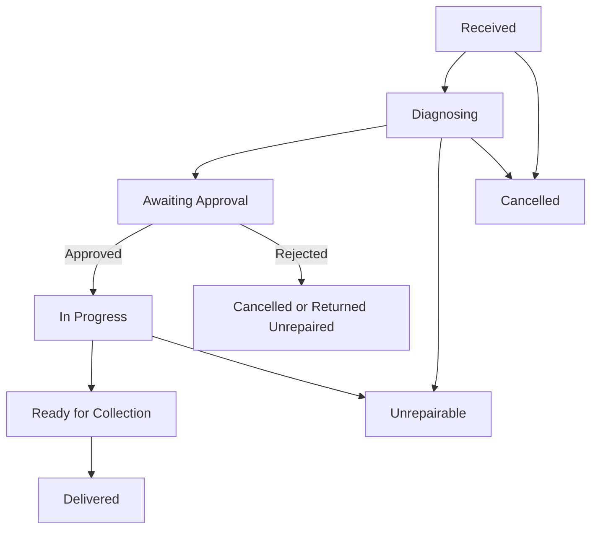

# ServiceFlow LK — Project Master Plan

> **Document status:** Product and engineering specification, v1.0  
> **Product type:** Multi-tenant SaaS for repair and service businesses  
> **Initial market:** Sri Lankan laptop, desktop, and mobile-device repair shops  
> **Primary stack:** ASP.NET Core Web API, Angular, SQL Server, Entity Framework Core  
> **Development assistant:** Cursor AI  
> **Important:** This document describes intended functionality, not functionality already implemented.

---

## 1. What is ServiceFlow LK?

ServiceFlow LK is a cloud-based software platform that helps repair shops manage their daily work from the moment a customer brings in a device until the device is returned and payment is recorded.

Instead of tracking repairs using notebooks, spreadsheets, phone calls, and WhatsApp messages, shop staff use a shared system to record customers and devices, create repair tickets, assign technicians, update repair progress, track spare parts, prepare quotations, issue invoices, and monitor business performance.

**Commercial goal:** Sell subscriptions to independent repair and service businesses.  
**Portfolio goal:** Demonstrate production-oriented full-stack .NET engineering, Angular UI design, SQL Server modeling, authorization, tenant isolation, testing, and deployment.

### What this project is not

- Not a generic CRUD demo or a full ERP system.
- Not an AI diagnosis system in its first release.
- Not a marketplace for finding repair technicians.
- Not a payment gateway or accounting platform.
- Not a completed production application merely because this specification exists.

### Initial scope

One shop location per business, one currency (LKR), employee accounts, customer/device records, repair tickets, inventory basics, quotations, invoices, payments, and customer status tracking. Architect for multiple tenants from day one; defer multi-branch operations and complex subscription billing.

---

## 2. Real-world example: What happens in a repair shop?

**Example:** A customer brings a Dell laptop that does not charge.

1. **Reception receives the laptop.** The employee searches for the customer by phone number. If not found, they create a customer record.
2. **Reception registers the device.** They record device type, brand, model, serial number if available, visible condition, and optional photos. Never request or store device passwords or unlock codes.
3. **Reception opens a repair ticket.** The system assigns a unique shop-specific ticket number (for example, `REP-2026-000123`), stores the reported problem, records intake notes, and sets status to `Received`.
4. **Manager assigns a technician.** The technician sees the assigned ticket on their dashboard.
5. **Technician diagnoses the problem.** They add diagnosis notes and recommended repair work. Status changes to `Diagnosing` and then `AwaitingApproval` when a quotation is ready.
6. **Reception/manager sends a quotation.** The customer accepts or rejects it. The system records the decision, actor, time, and quotation version. No repair requiring approval begins without that approval.
7. **Technician repairs the device.** Status changes to `InProgress`. Parts consumed are recorded, and stock is reduced in a database transaction.
8. **Technician completes the repair.** Status becomes `ReadyForCollection`; staff can notify the customer.
9. **Customer collects the laptop.** Staff issue an invoice, record full or partial payment, note any balance, and mark the device `Delivered` after the required handover checks.
10. **Owner reviews the dashboard.** They can see open jobs, average turnaround, parts usage, payments, and outstanding balances.

**Exception paths:** The customer can decline the quotation; a device can be unrepairable; a job can be cancelled; a required part can be unavailable; a delivered device may return for a warranty follow-up. Every exceptional transition must be explicit and auditable.

### Repair status workflow



Status changes must be validated server-side. Do not allow arbitrary jumps between states. Store a status-history row for each transition. A separate payment status must not be confused with the repair status.

---

## 3. Who uses the application?

| Actor | Main responsibility | Access restrictions |
|---|---|---|
| Platform administrator | Operate the SaaS platform, manage tenant lifecycle and support | No unrestricted browsing of customer business data; privileged access must be explicit and audited |
| Business owner | Manage shop, employees, finances, settings, subscription | Only their own tenant |
| Shop manager | Assign work, manage customers, parts, quotations, and reporting | Only permitted tenant operations |
| Receptionist | Register customers/devices, open tickets, communicate status, prepare invoices | Limited finance and employee-management access |
| Technician | View assigned jobs, record diagnoses, update approved repair stages, request parts | Cannot view unrelated tenants or unrestricted financial reports |
| Customer | Check the status of their own repair using a secure status link | No employee dashboard or other customers' information |

**MVP tenancy rule:** Each employee account belongs to one tenant. A future version may support users belonging to multiple tenants through explicit membership records.

---

## 4. Product features and acceptance criteria

### 4.1 Tenant onboarding and business settings — MVP

**Features**
- Business registration with name, contact details, address, and unique slug.
- First registered user becomes business owner.
- Business profile, logo, receipt footer, and timezone configuration (default `Asia/Colombo`).
- Employee invitation, activation, deactivation, and role assignment.
- Tenant suspension and subscription-status checks.

**Acceptance criteria**
- Registration creates tenant and owner atomically.
- Two businesses can use the same platform without seeing each other's records.
- Suspended tenants cannot perform normal business operations.
- Employee invitations expire and cannot be reused.

### 4.2 Authentication and authorization — MVP

**Features**
- Secure login, logout, password reset, and session renewal.
- ASP.NET Core Identity with strong password hashing.
- Owner, Manager, Receptionist, Technician roles with fine-grained permissions.
- Server-side ownership and permission checks.

**Acceptance criteria**
- Anonymous users cannot access private endpoints.
- A technician cannot access another tenant's tickets or edit unauthorized jobs.
- Session termination invalidates the relevant session/refresh credential.
- Rate limiting and generic authentication errors are implemented.

### 4.3 Customer management — MVP

**Features**
- Create/edit customers; name, phone, optional email and address.
- Search by name or phone; pagination.
- View customer's devices, past repairs, invoices, and outstanding balances according to role.
- Prevent accidental duplicates with warnings, not unsafe forced merging.

**Acceptance criteria**
- Customer searches are tenant-scoped.
- Phone numbers support Sri Lankan formats and are normalized where practical.
- Sensitive customer information is not exposed in public repair-status pages.

### 4.4 Device management — MVP

**Features**
- Register device type, brand, model, optional serial number, color, condition, accessories, and notes.
- Attach intake photos with size/type restrictions.
- Link a device to a customer and view its repair history.

**Acceptance criteria**
- A ticket's device must belong to the same tenant and customer as the ticket.
- Photos are stored privately, not in publicly readable buckets.
- Device passwords/unlock codes are not collected or stored.

### 4.5 Repair tickets — MVP, highest priority

**Features**
- Generate unique per-tenant ticket numbers.
- Record customer, device, issue, intake condition, priority, and optional target date.
- Assign and reassign technicians.
- Add internal notes and diagnosis notes.
- Change status using approved transitions.
- Record status history, responsible actor, and timestamp.
- Search/filter by number, status, technician, customer, and date.
- Support cancellation, declined quotation, and unrepairable outcomes.

**Acceptance criteria**
- Invalid status transitions are rejected with a clear validation error.
- Concurrent updates use optimistic concurrency (`rowversion`) or equivalent checks.
- Every status change is auditable.
- Tenant and ticket ownership are validated on all reads and writes.

### 4.6 Technician workspace — MVP

**Features**
- My assigned jobs, priorities, and pending tasks.
- View permitted device details and job notes.
- Record diagnosis, work performed, parts needed, and completion notes.
- Submit job as ready for collection.

**Acceptance criteria**
- Technicians see only authorized tickets.
- Technicians cannot approve their own customer quotation on the customer's behalf.

### 4.7 Inventory and spare parts — MVP basic

**Features**
- Product/part catalog: SKU, name, unit, cost, selling price, reorder level.
- Stock receipts, manual adjustments with reasons, and consumption on repair tickets.
- Stock movement history and low-stock list.

**Acceptance criteria**
- Stock cannot silently become negative; define and enforce a stock policy.
- Part consumption and stock decrement are atomic.
- Repeated requests do not double-consume stock.
- Inventory changes record actor, reason, and reference ticket.

### 4.8 Quotations — MVP

**Features**
- Prepare estimated parts, labor, discounts, and total.
- Issue quotation PDF or shareable quotation summary.
- Record customer approval or rejection and timestamp.
- Maintain revisions without overwriting approved versions.

**Acceptance criteria**
- Approved quotations are immutable; changes require a new revision.
- Totals are calculated server-side using decimal arithmetic.
- Approval evidence is retained.

### 4.9 Invoices and payments — MVP

**Features**
- Generate invoice from completed repair/approved charges.
- Itemize labor, parts, discount, and applicable tax configuration.
- Generate PDF invoice and receipt.
- Record cash, bank transfer, or other manually confirmed payment methods.
- Support partial payments and outstanding balances.

**Acceptance criteria**
- Invoice numbers are unique per tenant and are not reused.
- Issued invoices cannot be silently edited; corrections use an explicit reversal/credit process.
- Payment posting is transactional and idempotent where retries are possible.
- Currency is LKR for MVP. Tax rules must be configured and verified with a qualified local adviser before production use.

### 4.10 Customer repair-status page — MVP

**Features**
- Generate a high-entropy, expiring, revocable link to check ticket progress.
- Display only minimal status information and public-facing updates.
- Show an optional estimated completion date and shop contact details.

**Acceptance criteria**
- No guessable sequential public ticket IDs grant access.
- No internal diagnosis notes, customer PII, or other tickets are exposed.
- Rate limiting and access logging are enabled.

### 4.11 Dashboard and reports — MVP basic

**Features**
- Open jobs, overdue jobs, jobs by status, and technician workload.
- Repairs completed by period and average turnaround time.
- Invoice totals, payments received, and outstanding balances.
- Low-stock parts and most-used parts.

**Acceptance criteria**
- All aggregates are tenant-scoped.
- Reports clearly distinguish invoiced revenue from cash collected.
- Date filters use a consistent timezone policy.

### 4.12 Notifications — Phase 2

- Email notifications for ticket creation, quotation readiness, and collection readiness.
- Optional WhatsApp messaging using an approved provider and opt-in consent.
- Retryable background jobs and delivery status.
- Templates and notification preferences.

### 4.13 SaaS subscription management — Phase 2

- Starter, Business, and Pro plan configuration.
- Trial periods, usage limits, billing cycles, and payment tracking.
- Subscription renewal and expiry workflows.
- Platform-admin tenant management and audit history.

**Initial pricing hypotheses to validate:** Starter LKR 2,500/month, Business LKR 5,000/month, Pro LKR 9,000/month. These are experiments, not verified market prices.

### 4.14 Future enhancements — not MVP

- Multiple branches and cross-branch stock transfers.
- Advanced purchase orders and supplier management.
- Customer self-service booking.
- Warranty return and repeat-repair workflows.
- Technician mobile/PWA offline support.
- Barcode/QR intake labels.
- AI-assisted ticket categorization and repair-note summarization (human reviewed).
- Advanced analytics and accounting integrations.

---

## 5. Technical architecture

### 5.1 Architectural style

Use a **modular monolith with Clean Architecture**. Do not start with microservices.

```text
Angular SPA / customer portal
            |
       HTTPS / API
            |
     ASP.NET Core API
            |
   Application use cases
            |
       Domain model
            ^
            |
 Infrastructure adapters
    |       |       |
 SQL Server  Blob   Background jobs
```

### 5.2 Repository layout

```text
ServiceFlowLK/
├── backend/
│   ├── ServiceFlow.sln
│   ├── src/
│   │   ├── ServiceFlow.Api/
│   │   ├── ServiceFlow.Application/
│   │   ├── ServiceFlow.Domain/
│   │   └── ServiceFlow.Infrastructure/
│   └── tests/
│       ├── ServiceFlow.UnitTests/
│       └── ServiceFlow.IntegrationTests/
├── frontend/
│   └── serviceflow-web/
├── docs/
├── deployment/
├── .github/workflows/
├── PROJECT_MASTER_PLAN.md
└── README.md
```

**Dependencies:** Domain has no framework/infrastructure dependency. Application depends on Domain. Infrastructure depends on Application/Domain. API composes Application and Infrastructure. Use feature folders within Application and Angular.

### 5.3 Backend standards

- Supported .NET LTS, ASP.NET Core Web API, EF Core, SQL Server.
- Controllers or minimal APIs consistently; use `/api/v1` versioned routes.
- DTOs at API boundary; never expose EF entities directly.
- Dependency injection, validation, centralized Problem Details error responses.
- Async database I/O and cancellation tokens.
- Pagination and filtering on list endpoints.
- OpenAPI documentation and health checks.
- Explicit database transactions for stock, invoicing, and payments.
- Structured logging with correlation IDs; no secrets or sensitive PII in logs.
- EF Core migrations reviewed and applied via controlled deployment.

### 5.4 Frontend standards

- Angular standalone components, TypeScript strict mode, lazy feature routes.
- Typed reactive forms and accessible form validation.
- Responsive layout for desktop and mobile browsers.
- Auth/session service, route guards for UX, backend authorization for security.
- Reusable tables, dialogs, loading, empty, and error states.
- Avoid unnecessary global state-management complexity in MVP.

### 5.5 Database tables (planned)

| Group | Tables |
|---|---|
| SaaS | `Tenants`, `TenantSettings`, `Subscriptions` (later), `SubscriptionPlans` (later) |
| Identity | ASP.NET Core Identity tables, tenant-aware user/role extensions |
| Customer | `Customers`, `Devices` |
| Repairs | `RepairTickets`, `TicketAssignments`, `TicketStatusHistory`, `TicketNotes`, `TicketAttachments` |
| Inventory | `Products`, `StockMovements`, `TicketParts` |
| Billing | `Quotations`, `QuotationItems`, `Invoices`, `InvoiceItems`, `Payments` |
| Operations | `AuditLogs`, `NotificationOutbox` (later) |

**Schema requirements:**
- GUID external IDs; tenant-owned entities include non-null `TenantId`.
- Tenant-scoped unique constraints for ticket/invoice numbers and business identifiers.
- Tenant-scoped foreign keys where appropriate; validate customer-device-ticket consistency.
- `decimal(18,2)` for monetary amounts; UTC timestamps.
- `rowversion` for concurrent repair-ticket edits.
- Appropriate indexes, e.g. `(TenantId, Status, CreatedAt)`.
- No hard deletes of issued financial records or audit trails.

### 5.6 Core API contract (planned)

| Area | Endpoints |
|---|---|
| Auth | `POST /api/v1/auth/login`, `/refresh`, `/logout`; `GET /api/v1/me` |
| Tenant | `POST /api/v1/tenants/register`, `GET /api/v1/tenants/current` |
| Staff | `GET /api/v1/users`, `POST /api/v1/users/invitations` |
| Customers | `GET/POST /api/v1/customers`, `GET/PUT /api/v1/customers/{id}` |
| Devices | `POST /api/v1/devices`, `GET /api/v1/devices/{id}` |
| Tickets | `GET/POST /api/v1/tickets`, `GET /api/v1/tickets/{id}`, `PATCH /api/v1/tickets/{id}/status` |
| Assignments | `POST /api/v1/tickets/{id}/assignments` |
| Ticket history | `GET /api/v1/tickets/{id}/history` |
| Inventory | `GET/POST /api/v1/products`, `POST /api/v1/stock-movements` |
| Ticket parts | `POST /api/v1/tickets/{id}/parts` |
| Quotations | `POST /api/v1/tickets/{id}/quotations` |
| Invoices | `POST /api/v1/tickets/{id}/invoices`, `GET /api/v1/invoices/{id}/pdf` |
| Payments | `POST /api/v1/invoices/{id}/payments` |
| Reports | `GET /api/v1/reports/dashboard` |
| Customer status | Dedicated minimal-data endpoint using expiring status token |

**API rules:** Client never supplies authoritative `TenantId`; every resource lookup and mutation is tenant-scoped. Use idempotency protection on payment/invoice creation, permission checks on every operation, and clear validation errors.

---

## 6. Multi-tenant security design

**Strategy:** Shared SQL Server database and shared schema with tenant ownership columns. This is a cost-effective initial design but requires strong isolation.

1. Authenticate the user through ASP.NET Core Identity.
2. Resolve the active tenant from trusted server-side user membership, not an arbitrary header.
3. Enforce tenant scope on all reads, updates, deletes, aggregates, and file access.
4. Use EF Core global query filters as defense in depth, not the sole protection.
5. Validate ownership of related records (customer, device, technician, invoice, etc.).
6. Restrict or prohibit `IgnoreQueryFilters()` in normal business code.
7. Use tenant-scoped constraints to prevent cross-tenant foreign-key relationships.
8. Add cross-tenant negative tests for every critical endpoint.
9. Platform support access, if added, must require explicit privileged workflow and audit logging.

**Browser session recommendation:** Prefer secure, HttpOnly, Secure cookies with a same-origin API/BFF-style setup where feasible; implement CSRF protection for cookie-authenticated mutations. Do not store long-lived tokens in local storage. Enforce TLS and secure cookie settings.

**Additional security controls:** Rate limits, generic login/reset errors, secure password reset, invitation expiry, file content validation, private blob storage, anti-malware scanning where appropriate, secure secret storage, least-privilege database accounts, dependency updates, backup and restore testing, and incident logging. Never store device unlock credentials.

---

## 7. Business rules that must be explicit

- **Ticket numbering:** Unique within tenant; allocate atomically under concurrency.
- **Customer/device relationship:** Device must belong to ticket customer and tenant.
- **Assignment:** Only authorized manager/owner can assign; technician must belong to same tenant.
- **Approval:** Record quotation version and approval/rejection evidence before approved work.
- **Status changes:** Allowed transition graph enforced in Domain/Application, not just Angular.
- **Parts:** Consume stock once only; use transactions and idempotency checks.
- **Money:** Server calculates line totals, discounts, taxes, and invoice totals using decimals.
- **Payments:** Do not allow accidental overpayment or duplicate posting; handle partial payments.
- **Delivery:** Record handover date, staff actor, and payment/balance policy.
- **Audit:** Preserve history of financial changes, assignments, and critical status changes.
- **Timezone:** Store UTC, display `Asia/Colombo`; reporting date boundaries must be consistent.

---

## 8. Task plan and implementation order

> Cursor must implement **one phase at a time**, run builds/tests, report results, and wait for approval before proceeding. Do not mark tasks complete without evidence.

### Phase 0 — Customer discovery and requirements

- [ ] Interview at least five repair shops about current repair tracking.
- [ ] Identify common ticket fields and quotation/approval workflow.
- [ ] Confirm whether shops need mobile-first intake, receipt printing, or offline access.
- [ ] Find one willing pilot customer.
- [ ] Finalize MVP exclusions and success metrics.

**Done when:** At least one real shop agrees to review or pilot the workflow.

### Phase 1 — Repository and foundation

- [x] Create monorepo, backend solution, and Angular workspace.
- [x] Configure Clean Architecture project references.
- [x] Add SQL Server/EF Core configuration and reviewed initial migrations.
- [x] Add health checks, OpenAPI, exception handling, logging, `.editorconfig`, `.gitignore`.
- [x] Add unit/integration test projects and CI build checks.
- [x] Document local setup and environment variables.

**Done when:** Backend and frontend build; health check runs; tests execute; secrets are not committed.  
**Verified:** 2026-11-21 — backend Release build OK; 11 tests passed; Angular production build OK; `InitialCreate` migration applied to local SQL Server; docs and CI workflow added.

### Phase 2 — Identity, tenants, and permissions

- [ ] Implement tenant and owner registration transaction.
- [ ] Implement secure login/logout/session management.
- [ ] Add employee invitations and roles.
- [ ] Add permission policies and active tenant context.
- [ ] Add tenant-scoped EF Core mappings and database constraints.
- [ ] Write cross-tenant isolation and authorization integration tests.

**Done when:** Tenant A cannot read or mutate Tenant B data under any tested route; anonymous/unauthorized calls are rejected.

### Phase 3 — Customers and devices

- [ ] Create customer entities, DTOs, validators, endpoints, and UI.
- [ ] Implement customer search and pagination.
- [ ] Create device entities and customer-device relationship checks.
- [ ] Add intake details and secure attachment storage.
- [ ] Write unit and integration tests.

**Done when:** Reception can register/search customers and their devices safely.

### Phase 4 — Repair ticket lifecycle

- [ ] Create ticket entity, numbering, priority, and status model.
- [ ] Implement ticket creation and detail views.
- [ ] Implement technician assignment and technician dashboard.
- [ ] Implement diagnosis, notes, allowed transitions, and history.
- [ ] Implement concurrency checks and filtered ticket list.
- [ ] Test all permitted/forbidden transitions and cross-tenant cases.

**Done when:** A repair can be tracked from receipt through ready-for-collection with complete history.

### Phase 5 — Inventory and quotations

- [ ] Implement parts catalog and stock movement ledger.
- [ ] Implement part consumption linked to tickets.
- [ ] Prevent duplicate/negative stock movements under concurrency.
- [ ] Implement quotation lines, totals, revisions, and approval tracking.
- [ ] Generate quotation PDF.
- [ ] Add transaction/integration tests.

**Done when:** Approved repair work can use tracked parts without corrupting stock balances.

### Phase 6 — Billing, payments, and customer portal

- [ ] Implement invoice issuance and immutable issued invoice records.
- [ ] Generate PDF invoices and receipts.
- [ ] Record partial/full payments and outstanding balance.
- [ ] Implement secure customer status link with expiry and revocation.
- [ ] Add financial correctness, idempotency, and access tests.

**Done when:** A completed job can be invoiced, paid, delivered, and checked by the customer securely.

### Phase 7 — Reports, QA, and deployment

- [ ] Implement owner dashboard and core reports.
- [ ] Add structured logs, health checks, alerts, and error monitoring.
- [ ] Add automated backend tests and frontend end-to-end smoke tests.
- [ ] Configure Docker/deployment manifests and GitHub Actions.
- [ ] Deploy to Azure with managed secrets and private file storage.
- [ ] Test backup restoration, access controls, and performance basics.
- [ ] Seed non-sensitive demo data and write operator documentation.

**Done when:** Pilot environment is stable, documented, monitored, and passes release checks.

### Phase 8 — Commercial pilot

- [ ] Onboard one shop and train its staff.
- [ ] Observe real ticket creation, updates, invoicing, and collection.
- [ ] Collect bugs, usability feedback, and requested features.
- [ ] Measure ticket completion, time saved, and repeat usage.
- [ ] Validate willingness to pay and proposed plans.
- [ ] Prioritize next release from observed evidence.

**Done when:** A real shop completes its normal repair workflow using the product and provides structured feedback.

---

## 9. Nonfunctional requirements

| Category | Requirement |
|---|---|
| Security | No cross-tenant data leaks; least-privilege roles; secure sessions |
| Reliability | Database transactions for inventory and money; recoverable failures |
| Performance | Paginated endpoints, indexed tenant queries, no unbounded lists |
| Observability | Structured logs, correlation IDs, health checks, actionable alerts |
| Accessibility | Keyboard-friendly UI, visible validation, readable contrast |
| Localization | LKR, Sri Lankan phone formats, `Asia/Colombo`, future Sinhala support |
| Privacy | Minimize personal data; secure attachments; define retention/deletion policy |
| Maintainability | Clean dependencies, automated tests, migration review, documented decisions |
| Availability | Backup/restore plan and documented maintenance procedure |
| Commercial | Tenant onboarding, support process, subscription limits in later phase |

---

## 10. Testing strategy

**Unit tests:** Ticket status rules, totals/discount calculations, permission decisions, stock calculations, numbering logic.

**Integration tests:** EF Core persistence, tenant isolation, authentication, API validation, inventory transactions, invoice/payment idempotency, concurrency conflicts.

**Frontend tests:** Customer/device forms, ticket creation, filtering, status updates, permission-based navigation, error and empty states.

**End-to-end pilot scenarios:**

1. Register Business A and owner; invite receptionist and technician.
2. Create customer and device; create repair ticket.
3. Assign technician, diagnose, prepare quotation, record approval.
4. Consume parts, complete repair, generate invoice, record partial/full payment.
5. Deliver device and verify status history, stock balance, and reports.
6. Register Business B; verify no Business A records are visible or modifiable.
7. Verify customer status token reveals only approved minimal information.
8. Retry invoice/payment/stock requests and verify no duplicate business effects.

---

## 11. Deployment and environments

- **Local:** Angular dev server, ASP.NET Core API, local SQL Server/SQL Server container.
- **Staging:** Production-like configuration, synthetic data, migration verification, security and smoke tests.
- **Production:** Azure-hosted API, Azure SQL, private Azure Blob Storage, monitoring, backups, managed secrets.
- **CI/CD:** Build, lint, test, scan dependencies, publish artifacts, deploy after approval.
- **Migrations:** Generate and review scripts; never run destructive production migrations automatically without review and backup.
- **Secrets:** Environment variables, local user secrets, and managed secret storage; never commit credentials.

---

## 12. Commercial launch and pricing hypotheses

**Initial buyer:** Owner of a small independent repair shop with 2–10 staff members.

**Core pitch:** "Know where every repair is, who is working on it, what parts were used, and whether the customer has paid."

**Pricing experiments (not validated):**
- Starter: LKR 2,500/month, up to two users.
- Business: LKR 5,000/month, up to five users.
- Pro: LKR 9,000/month, expanded team capacity and advanced reporting.

Start with a pilot, not automatic paid subscriptions. Interview customers about price sensitivity, onboarding effort, connectivity, and support expectations. Track hosting and messaging costs before committing to pricing.

**Potential metrics:** Active shops, weekly active employees, repair tickets created, percentage of jobs with complete history, average time to complete a repair, invoices issued, payment collection, churn, and support hours per tenant.

---

## 13. Portfolio deliverables

- [ ] Public GitHub repository with safe sample data and no secrets.
- [ ] Professional README with product overview and setup instructions.
- [ ] Architecture diagram and documented design decisions.
- [ ] ER diagram and migration history.
- [ ] OpenAPI specification and sample requests.
- [ ] Screenshots or demo video showing the complete repair journey.
- [ ] Unit/integration test results and CI pipeline.
- [ ] Live demonstration environment with synthetic demo account.
- [ ] Case study explaining business problem, engineering tradeoffs, and pilot feedback.

---

## 14. Cursor AI working agreement

When Cursor reads this file, it must follow these rules:

1. Treat this file as the product specification, **not proof of completed implementation**.
2. Before coding, inspect the actual repository, installed SDKs, and existing code.
3. State which phase and tasks are being implemented.
4. Propose a short plan and identify unclear business rules before making major changes.
5. Implement only the selected phase; avoid unrelated features or speculative abstractions.
6. Follow Clean Architecture and tenant-security constraints throughout.
7. Do not use client-provided tenant identifiers as authorization authority.
8. Do not hardcode passwords, secrets, or connection strings.
9. Do not execute destructive migrations or modify production resources without explicit approval.
10. Add tests for new business rules and security-sensitive behavior.
11. Run available builds/tests and report actual results, including failures.
12. Update the task checklist **only when verified**, and explain any deviations from this specification.
13. Keep the README, API docs, and architecture decisions synchronized with code changes.
14. Ask for confirmation before implementing optional paid integrations or deploying to production.

### Suggested Cursor instruction

```text
Read PROJECT_MASTER_PLAN.md fully and inspect the repository.
Tell me the current implementation status against the plan.
Recommend the next smallest phase with clear acceptance criteria.
Do not assume planned features are already built.
Implement only after presenting the plan, and validate with builds/tests.
Preserve tenant isolation, security, and financial data integrity.
```

---

## 15. Open decisions to resolve before implementation

- Exact .NET LTS and Angular versions available in the development environment. **Resolved for Phase 1:** target `net8.0` (LTS) with SDK 9.0.x; Angular 19 via `npx @angular/cli@19`; local SQL Server 2022 Developer.
- Whether the first pilot shop needs printed intake receipts and thermal-printer support.
- Whether repair quotations require customer signature, recorded verbal consent, or online approval.
- Whether negative inventory is ever allowed (recommended MVP default: no).
- Whether delivery is permitted with an outstanding balance and which role can authorize it.
- Required invoice wording, tax treatment, and local compliance requirements.
- Preferred notification channels and customer consent policy.
- File retention, customer-data deletion, and warranty record retention policy.

**Default execution priority:** Build and verify tenant security first, then the end-to-end repair lifecycle, then inventory/billing, then dashboards and commercial enhancements.
